# Production-Grade Verifiable RAG Chatbot

An enterprise-ready Retrieval-Augmented Generation (RAG) system built with **LangGraph**, **Chainlit**, and a cloud-hosted **Qdrant** vector database. Designed with strict citation guarantees, layout-aware document ingestion, semantic quality gating, conversational query contextualization, multi-provider model fallbacks, and structured JSON observability.

---

## 🏛 Architecture Overview

The system processes queries through a deterministic state machine orchestrated by **LangGraph**, enforcing strict grounding, semantic threshold gating, and verifiable citations.

```mermaid
flowchart TD
    %% Styling
    classDef startEnd fill:#1e293b,stroke:#475569,stroke-width:2px,color:#f8fafc;
    classDef nodeStyle fill:#0f172a,stroke:#3b82f6,stroke-width:2px,color:#f8fafc;
    classDef decisionStyle fill:#1e1b4b,stroke:#8b5cf6,stroke-width:2px,color:#c084fc;
    classDef actionStyle fill:#064e3b,stroke:#10b981,stroke-width:2px,color:#a7f3d0;
    classDef rejectStyle fill:#450a0a,stroke:#ef4444,stroke-width:2px,color:#fca5a5;
    classDef storageStyle fill:#172554,stroke:#38bdf8,stroke-width:2px,color:#bae6fd;

    START(["● START"]):::startEnd --> IntentClassifier["Node: intent_classifier<br/><i>(predict_intent)</i>"]:::nodeStyle

    %% Intent Routing
    IntentClassifier --> RouteIntent{"Conditional Edge:<br/>route_intent"}:::decisionStyle
    
    RouteIntent -- "greeting" --> GreetingNode["Node: greeting<br/><i>(Conversational Assistant Overview)</i>"]:::actionStyle
    GreetingNode --> END1(["● END"]):::startEnd

    RouteIntent -- "document_query /<br/>document_overview" --> RetrieveNode["Node: retrieve<br/><i>(Contextualization & Vector Search)</i>"]:::nodeStyle

    %% Retrieval Node Subgraph
    subgraph RetrievalEngine ["Retrieve Node: Contextualization & Search Workflow"]
        direction TB
        CheckHistory{"Multi-Turn Chat<br/>History Exists?"}:::decisionStyle
        CheckHistory -- "Yes (Turn >= 2)" --> ContextualizeQuery["contextualize_query<br/><i>(LLM resolves pronouns & references<br/>into standalone search query)</i>"]:::nodeStyle
        CheckHistory -- "No (Turn 1)" --> RawQuery["Use Raw User Query"]:::nodeStyle
        
        OverviewCheck{"Intent =<br/>document_overview?"}:::decisionStyle
        ContextualizeQuery --> SearchTarget
        RawQuery --> OverviewCheck
        OverviewCheck -- "Yes" --> OverviewQuery["Target: Title, Abstract,<br/>Summary metadata chunks"]:::nodeStyle
        OverviewCheck -- "No" --> SearchTarget["Unified Search Query"]:::nodeStyle
        OverviewQuery --> SearchTarget
        
        SearchTarget --> QdrantANN[("Qdrant Cloud<br/>gemini-embedding-001<br/>(k=8 chunks, 3072-dim)")]:::storageStyle
        QdrantANN --> ScoreEval["Extract Document Chunks<br/>& Cosine Similarity Scores"]:::nodeStyle
    end

    RetrieveNode --> RetrievalEngine
    RetrievalEngine --> RouteQuery{"Conditional Edge:<br/>route_query<br/>(max_score >= 0.68 OR overview?)"}:::decisionStyle

    %% Semantic Quality Gate
    RouteQuery -- "No (Score < 0.68)" --> RejectionNode["Node: rejection<br/><i>(Deterministic Rejection: 'I cannot find the answer...')</i>"]:::rejectStyle
    RejectionNode --> END2(["● END"]):::startEnd

    RouteQuery -- "Yes (Score >= 0.68)" --> GenerationNode["Node: generation<br/><i>(Structured Synthesis with Provenance)</i>"]:::actionStyle

    %% Generation Node & Fallbacks
    subgraph GenerationPipeline ["Generation Node & Resilience Engine"]
        direction TB
        ContextAssembly["Context Assembler<br/>Format [Page: X | Section: Y]<br/>Inject Last 6 Conversation Turns"]:::nodeStyle
        ContextAssembly --> PrimaryLLM["Primary Generator<br/><b>Groq (openai/gpt-oss-20b)</b><br/>LPU Fast Inference (temp=0.0)"]:::nodeStyle
        
        PrimaryLLM --> SuccessCheck{"Primary LLM<br/>Succeeded?"}:::decisionStyle
        SuccessCheck -- "Yes" --> PydanticValidation["Validate CitedAnswer Schema<br/>- is_answerable (bool)<br/>- answer (str)<br/>- source_pages (List[int])<br/>- source_sections (List[str])"]:::actionStyle
        SuccessCheck -- "No (HTTP 429/503/Error)" --> FallbackLLM["Fallback Generator<br/><b>Google Gemini (gemini-3.5-flash-lite)</b><br/>Automatic Failover"]:::actionStyle
        FallbackLLM --> PydanticValidation
    end

    GenerationNode --> GenerationPipeline
    GenerationPipeline --> AnswerableCheck{"is_answerable = True?"}:::decisionStyle
    AnswerableCheck -- "Yes" --> FinalAnswer["Synthesized Answer<br/>with 1-to-1 Page Citations"]:::actionStyle
    AnswerableCheck -- "No" --> ConservativeRejection["Default to Rejection Message<br/>Empty Citations"]:::rejectStyle

    FinalAnswer --> END3(["● END"]):::startEnd
    ConservativeRejection --> END3

    %% Persistence Sidecars
    subgraph DataPersistence ["Async Storage & Native Step Tracing"]
        SQLite[("SQLite (chat_history.db)<br/>WAL Mode • busy_timeout=60s<br/>asyncio.Lock() Serialized Writes")]:::storageStyle
        UI["Chainlit UI (app.py)<br/>cl.Step Tracing & Inline Provenance"]:::actionStyle
    end

    GreetingNode -.->|Persist Step| SQLite
    FinalAnswer -.->|Persist Step| SQLite
    ConservativeRejection -.->|Persist Step| SQLite
    RejectionNode -.->|Persist Step| SQLite
    SQLite -.->|Rehydrate Context| RetrieveNode
    FinalAnswer ==>|Stream Tokens| UI
    RejectionNode ==>|Stream Tokens| UI
    GreetingNode ==>|Stream Tokens| UI
```



---

## 📚 Ingested Document Profile & Research Summary (`pdf1_rag.pdf`)

The knowledge base indexes the scientific publication:
> **"A Capsule Network-Based Hybrid Model for Lung Nodule Detection"**  
> *Christoph Mattmann, Dominik Hahn, Marco Klaiber, Sören Wagner, Marc Fernandes, Manfred Rössle*  
> Published in: **Procedia Computer Science 270 (2025) 1517–1526** (29th KES International Conference).

### Executive Summary of the Paper
* **Core Problem:** Lung cancer is among the deadliest cancers worldwide. Early detection on Computed Tomography (CT) scans saves lives, but manual radiologist screening across hundreds of 2D/3D CT slices is time-consuming and error-prone. Traditional Convolutional Neural Network (CNN) Computer-Aided Detection (CAD) systems require massive annotated datasets, struggle with rotational/viewpoint spatial variations, and lack feature interpretability.
* **Proposed Solution:** A novel **three-stage hybrid CAD pipeline** combining:
  1. **Stage 1 (Initial Detection):** Fast candidate nodule bounding box proposal using YOLOv11.
  2. **Stage 2 (Verification & False Positive Reduction):** Spatial feature encoding and nodule classification using a Capsule Network (CapsNet).
  3. **Stage 3 (Refined Detection):** Secondary YOLOv11 detection stage incorporating CapsNet verification features.
* **Dataset Methodology:** Evaluated on a combined cohort of **LIDC-IDRI** and **Lung-PET-CT-Dx**:
  - *Patient Selection Rule:* From LIDC-IDRI, **only patients with no nodules in their entire CT scan were used** as negative controls. Patients with nodules were strictly excluded because LIDC-IDRI does not differentiate between benign and malignant nodules (which could be cancer, scar tissue, or benign granulomas).
  - *Cancerous Cases:* Verified malignant nodules were extracted from Lung-PET-CT-Dx.
* **Key Findings & Experimental Results:**
  - **Cropped Image CapsNet:** Classifying detected nodule Regions of Interest (ROI) achieved **95.57% accuracy**, significantly outperforming the Full Image CapsNet (**93.07%**).
  - **Pipeline Detection Accuracy:** The complete three-stage hybrid pipeline achieved **89.98% overall detection accuracy**.
  - **Error Trade-off:** While precision improved, overall accuracy was slightly lower than standalone YOLOv11 (**90.79%**) due to an increased rate of **False Negatives (FNs)**, predominantly in *Adenocarcinoma tumors* and *large cell carcinomas*.

---

## 🧪 Sample Evaluation Questions & Ground Truth

Users and evaluators can interact with the system using these verified conversation scenarios:

### Scenario A: Multi-Turn Coreference Resolution Benchmark
*Tests conversational query contextualization, pronoun resolution, and 1-to-1 page citations.*

| Turn | User Question | Expected Answer & Technical Ground Truth | Source Provenance |
| :--- | :--- | :--- | :--- |
| **Turn 1** | *"What was the overall detection accuracy of the proposed three-stage pipeline?"* | The proposed three-stage pipeline achieved an overall detection accuracy of **89.98%**. | Page 1, Page 6 |
| **Turn 2** | *"How did that compare to using the standalone detection model by itself?"* | Standalone YOLOv11 achieved **90.79%** detection accuracy, which is slightly higher than the 89.98% of the hybrid pipeline. | Page 1, Page 6 |
| **Turn 3** | *"What specific type of error caused the accuracy to drop in the hybrid approach?"* | The drop in overall accuracy was caused by an increased number of **False Negatives (FNs)** in the verification stage. | Page 1, Page 6 |
| **Turn 4** | *"Which specific tumor types from the dataset were most frequently misclassified in that way?"* | **Adenocarcinoma tumors** and **large cell carcinomas** showed an increased proportion of False Negatives. | Page 7 |

---

### Scenario B: Dataset Inclusion & Methodology Benchmark
*Tests multi-turn reasoning and precise retrieval of scientific exclusion criteria.*

| Turn | User Question | Expected Answer & Technical Ground Truth | Source Provenance |
| :--- | :--- | :--- | :--- |
| **Turn 1** | *"Which two datasets were combined to evaluate this approach?"* | The approach was evaluated on a combination of the **LIDC-IDRI** dataset and the **Lung-PET-CT-Dx** dataset. | Page 4 (Section 3.1) |
| **Turn 2** | *"Were all the patients from the first dataset included in the training process?"* | **No.** Only patients from LIDC-IDRI who had **no nodules in the entire CT image** were included as negative controls. | Page 4 (Section 3.1) |
| **Turn 3** | *"Why were the other patients excluded?"* | Because LIDC-IDRI does not differentiate between benign and malignant nodules, meaning nodules could represent cancerous tumors, scar tissue, or benign findings. | Page 4 (Section 3.1) |

---

### Scenario C: Architectural & Comparative Deep-Dives
*Tests synthesis of technical rationale and model comparison.*

* **Question:** *"What are the three stages of the hybrid model proposed in the paper?"*  
  **Expected Answer:** Stage 1: Initial nodule candidate detection via YOLOv11; Stage 2: False positive verification and feature encoding via Capsule Network (CapsNet); Stage 3: Refined nodule detection via secondary YOLOv11. *(Pages 1, 3)*
* **Question:** *"Why was a Capsule Network chosen for the verification stage instead of a standard CNN?"*  
  **Expected Answer:** Capsule Networks preserve spatial hierarchies and viewpoint relationships between features (using vector-based capsules and dynamic routing) and require significantly fewer training samples than traditional CNNs. *(Pages 1, 3)*
* **Question:** *"How did the Cropped Image CapsNet compare to the Full Image CapsNet classifier?"*  
  **Expected Answer:** The Cropped Image CapsNet (using only nodule ROIs) achieved **95.57% classification accuracy**, outperforming the Full Image CapsNet which achieved **93.07%**. *(Pages 1, 6)*

---

### Scenario D: Conversational Greeting & Out-of-Domain Semantic Quality Gate
*Tests intent classification routing and deterministic $0.00 cost rejection.*

* **Greeting (Intent Prediction Bypass):**  
  *User:* *"Hello, what can you help me with?"*  
  *Assistant:* Welcoming greeting explaining system capabilities, 1-to-1 page citations, and summarizing the indexed lung cancer nodule detection paper without hitting the vector database.
* **Out-of-Domain Query (Semantic Gate $\text{Score} < 0.68$):**  
  *User:* *"What was Apple's stock closing price on NASDAQ yesterday?"*  
  *Cosine Score:* `~0.56` ($< 0.68$) $\rightarrow$ *Deterministic Rejection:*  
  > *"I cannot find the answer to this question in the document."* (0 LLM tokens, $< 80\text{ ms}$).

---

## 📐 Key Design Decisions & Technical Architecture

### 1. Document Partitioning & Coherent Chunking Strategy (`ingestion.py`)
- **Digital Text-Only Extraction (Zero OCR Overhead)**: Assumes input documents contain digital text streams. All embedded raster images and decorative graphics are explicitly bypassed. Employs lightweight native `pypdf` extraction, executing in sub-seconds with zero OCR dependencies (`tesseract`, `poppler`, `libgl1`) and zero GPU/PyTorch downloads.
- **Stateful Section Tracking**: When iterating through layout elements, the active section is maintained in a state variable (`current_section`) whenever a header or title element is encountered. Every resulting chunk inherits this section context.
- **Strict Page-Boundary Isolation**: Unlike naive contiguous text splitters that allow chunks to span across page breaks, our buffer flushes whenever `page_number` changes. This guarantees a **strict 1-to-1 mapping** between text chunks and their physical page numbers, completely eliminating page citation hallucinations.
- **Coherent Chunk Size (1,200 chars) & Overlap (250 chars)**: Sized specifically to preserve complete contextual units (such as dataset descriptions, experimental settings, and comparative result tables) without mid-sentence truncations. Slices `pdf1_rag.pdf` into 65 clean, dense chunks.
- **Embedding Model**: `models/gemini-embedding-001` (3,072 dimensions) loaded into Qdrant Cloud with Cosine Distance.

---

### 2. Conversational Query Contextualization (`graph.py`)
In multi-turn technical dialogues, users frequently use pronouns and implicit references:
- *Turn 1:* "What was the overall detection accuracy of the proposed three-stage pipeline?"
- *Turn 2:* "How did **that** compare to using the standalone detection model by itself?"
- *Turn 3:* "Why were the **other patients** excluded?"

Vector databases cannot match pronouns against indexed document text. Before searching Qdrant:
1. When prior chat history exists, [`contextualize_query`](file:///d:/henkel_GenAI/graph.py#L380-L435) automatically invokes a lightweight LLM reformulation prompt:
   - *"How did that compare to using the standalone detection model by itself?"* $\rightarrow$ *"Detection accuracy of the standalone detection model compared to the proposed three-stage pipeline."*
   - *"Why were the other patients excluded?"* $\rightarrow$ *"Why were patients with nodules excluded from the training set?"*
2. **Hybrid Search Fusion**: The retriever queries Qdrant with both the contextualized query and original query, deduplicating candidate chunks by score.

---

### 3. Calibrated Semantic Quality Gate (Cosine Threshold: 0.68)
- Instead of unconditionally prompting the LLM when no relevant documents exist, the graph evaluates the maximum cosine similarity score from Qdrant.
- If $\max(\text{scores}) < 0.68$ (and query is not an overview request), the system routes immediately to the **Rejection Node**, which deterministically returns:
  > *"I cannot find the answer to this question in the document."*
- **Calibration Precision**:
  - Out-of-scope queries (*"What is the stock price of Apple on NASDAQ?"*) score `~0.56` $\rightarrow$ **Cleanly Rejected**.
  - Factual document inquiries score `0.70` to `0.85` $\rightarrow$ **Passed to Generation**.
- **Benefits**: Zero LLM token consumption for irrelevant questions, zero hallucination risk, and sub-100ms response time for out-of-scope queries.

---

### 4. Primary LLM with Automatic Fallback (`.with_fallbacks()`)
- **Primary Generator**: Groq (`openai/gpt-oss-20b`) provides sub-second inference on specialized LPU silicon with full tool-calling and structured Pydantic compliance.
- **Fallback Generator**: Google Gemini (`gemini-3.5-flash-lite`) is bound using LangChain's `.with_fallbacks()`. In the event of API rate limits (HTTP 429), transient service interruptions (HTTP 503), or provider downtimes, execution fails over automatically to Gemini without interrupting the user's session.

---

### 5. Pydantic Output Enforcement (`CitedAnswer`)
The generation node binds a Pydantic schema using `.with_structured_output(CitedAnswer)`:
```python
class CitedAnswer(BaseModel):
    is_answerable: bool
    answer: str
    source_pages: List[int]
    source_sections: List[str]
```
- **Guaranteed Output Schema**: The model cannot return unstructured conversational banter. It must return a validated JSON payload adhering to this schema.
- **Field Sanitization**: Built-in Pydantic validators automatically de-duplicate, sort, and cast cited pages and section strings.
- **Double-Check Grounding**: If `is_answerable` is `False`, the system deterministically clears citations and outputs the standard rejection message.

---

### 6. Production SQLite Concurrency & WAL Architecture (`database.py`)
To prevent `"database is locked"` errors under high-concurrency Chainlit streaming events:
- **Write-Ahead Logging (WAL)**: `PRAGMA journal_mode = WAL;` and `PRAGMA synchronous = NORMAL;`. Readers never block writers, and writers never block readers.
- **Async Mutex Write Lock (`_get_write_db`)**: An internal `asyncio.Lock()` serializes all write operations (`create_step`, `update_step`, `create_element`, `update_thread`, `create_user`) cooperatively in the asyncio event loop.
- **60-Second Busy Timeout**: All connections configure `timeout=60.0` and `PRAGMA busy_timeout = 60000;`.
- **Public Universal ACL**: Implements `UniversalIdentifier` ensuring thread authorization always succeeds regardless of browser session cookies.
- **Docker Mount Auto-Detection (First-Run Resilience)**: When running on a fresh host machine where `chat_history.db` does not exist yet, Docker automatically creates the host path as a directory. `database.py` detects this via `os.path.isdir()`, logs an informational warning, and safely initializes `chat_history.db/chat_history.sqlite` inside the directory, completely eliminating startup crashes or filesystem permission errors.

---

### 7. Production JSON Observability (`logger.py`)
- Emits single-line JSON records to `stdout` compatible with standard cloud logging solutions (Datadog, AWS CloudWatch, GCP Cloud Logging).
- Explicitly tracks:
  - Vector similarity scores (`similarity_scores`, `max_similarity_score`)
  - Retrieval and generation latency in milliseconds (`latency_ms`)
  - Model provenance and fallback indicators (`is_fallback`, `model`)
  - Output answerability and citation volume (`citations_count`)

---

## 🔍 Native UI Step Tracing & Observability

All execution traces and routing decisions are displayed directly inside the **Chainlit UI** in real time:

### Where to Find Tracing in the UI:
1. **Interactive Step Cards in the Chat Feed**:
   - Right above each assistant response, expandable `cl.Step` cards trace every phase of the pipeline:
     - **`Intent Prediction`**: Displays the detected user intent (`greeting`, `document_overview`, or `document_query`) and chosen branch.
     - **`Retrieving documents`**: Displays candidate chunks fetched from Qdrant Cloud, individual cosine similarity scores, and the maximum score.
     - **`Evaluating similarity`**: Displays the semantic quality gating decision (verifying if $\max(\text{score}) \ge 0.68$).
     - **`Synthesizing answer with citations`**: Displays LLM execution details (context chunk count, multi-turn context turns, primary Groq / fallback Gemini provider).
   - **How to inspect**: Click directly on any step card in the chat to expand and inspect its input payloads, outputs, and execution metrics.

2. **Inline Provenance Element**:
   - At the bottom of verified answers, click the **`Source Citations & Provenance`** inline card to view strict 1-to-1 page numbers, section headers, retrieval cosine score, and context counts.

---

## 🚀 Quickstart & Deployment Instructions

Follow these exact steps to run the containerized application:

### Step 1: Clone the repository
```bash
git clone https://github.com/ZiadHegazy/Henkel_GenAI_Task.git
cd Henkel_GenAI_Task
```

### Step 2: Configure Environment Variables
Copy `.env.example` to `.env` and fill in your API credentials:
```bash
cp .env.example .env
```
Ensure the following variables are configured in `.env`:
- `QDRANT_URL`: Qdrant cluster endpoint
- `QDRANT_API_KEY`: Qdrant cluster authentication token
- `GROQ_API_KEY`: Groq API key for LPU generation
- `GEMINI_API_KEY`: Google AI Studio API key (for embeddings & fallback generation)
- `GROQ_MODEL`: `openai/gpt-oss-20b` (fast primary model)
- `GEMINI_MODEL`: `gemini-3.5-flash-lite` (fallback model)
- `EMBEDDING_MODEL`: `models/gemini-embedding-001` (3072-dim active Google AI Studio model)
- `SIMILARITY_THRESHOLD`: `0.68`
- `TOP_K_CHUNKS`: `8`
- `CHAINLIT_AUTH_SECRET`: Random 32+ character hex string for signing session JWTs
- `CHAT_DB_PATH`: Path to SQLite database file (`chat_history.db`)

### Step 3: Build the Docker Image
```bash
docker build -t henkel_rag_task .
```

### Step 4: Run the Application Container

> [!IMPORTANT]
> **First-Time Evaluation & Docker Volume Mount Behavior:**  
> When evaluating this project on a fresh laptop/machine, `chat_history.db` does not exist initially on the host.
> 
> **Option A: Pre-create the file (Recommended):**  
> Creating an empty file prior to launching ensures Docker mounts it cleanly as a single SQLite database file:
> - **Linux / macOS / Git Bash:**
>   ```bash
>   touch chat_history.db
>   docker run -p 8000:8000 --env-file .env -v $(pwd)/chat_history.db:/app/chat_history.db henkel_rag_task
>   ```
> - **Windows (PowerShell):**
>   ```powershell
>   New-Item chat_history.db -ItemType File -Force
>   docker run -p 8000:8000 --env-file .env -v ${PWD}/chat_history.db:/app/chat_history.db henkel_rag_task
>   ```
>
> **Option B: Run directly without pre-creating:**  
> If you run `docker run` directly without creating the file first, Docker will automatically create `chat_history.db` as a **directory** on your host.  
> **Our system is engineered to handle this automatically**: [`database.py`](file:///d:/henkel_GenAI/database.py#L54-L64) detects `os.path.isdir(db_path)` and automatically initializes the SQLite database inside `chat_history.db/chat_history.sqlite`. The container will boot up, create the database schema, and persist your chat history without any errors!

Open your browser and navigate to: **[http://localhost:8000](http://localhost:8000)**  
Access is completely public (no login required). Your conversation threads and step telemetry automatically persist to `chat_history.db`.

---

## 📄 Document Ingestion (Local or Containerized)

The ingestion script extracts digital text, preserves 1-to-1 page boundaries, updates section headers, and populates the Qdrant vector index.

```bash
# Ingest a PDF document into Qdrant Cloud (Local or inside Docker)
python ingestion.py --file pdf1_rag.pdf --collection rag_documents

# Ingest and recreate collection from scratch
python ingestion.py --file pdf1_rag.pdf --collection rag_documents --recreate
```

> [!TIP]
> **Zero OCR Overhead**: Ingestion operates in fast digital text mode, bypassing all embedded images. The Docker image does not require `tesseract-ocr`, `poppler-utils`, `libgl1`, or heavy PyTorch / CUDA models, resulting in an ultra-lightweight image that builds in seconds.
