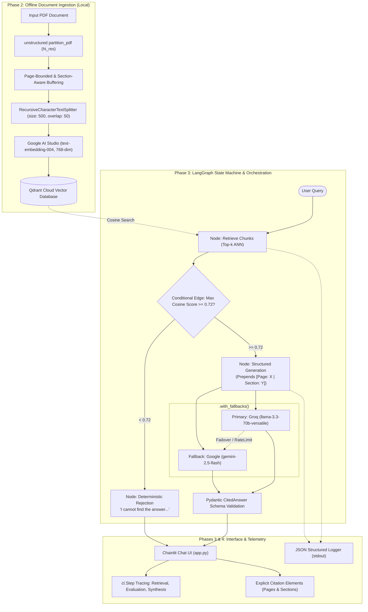

# Production-Grade Verifiable RAG Chatbot

An enterprise-ready Retrieval-Augmented Generation (RAG) system built with **LangGraph**, **Chainlit**, and a cloud-hosted **Qdrant** vector database. Designed with strict citation guarantees, layout-aware document ingestion, semantic quality gating, multi-provider model fallbacks, and structured JSON observability.

---

## 🏛 Architecture Overview

The system processes queries through a deterministic state machine orchestrated by **LangGraph**, enforcing strict grounding, semantic threshold gating, and verifiable citations.



---

## 📐 Key Design Decisions & Justifications

### 1. Document Partitioning & Chunking Strategy
- **Layout-Aware Partitioning (`unstructured` hi_res)**: Standard text extraction flattens PDF layouts, losing critical structural distinctions like headers, footers, tables, and multi-column flows. The `hi_res` strategy uses layout detection models and OCR to categorize elements (`Title`, `Header`, `NarrativeText`, `Table`).
- **Stateful Section Tracking**: When iterating through layout elements, the active section is maintained in a state variable (`current_section`) whenever a header or title element is encountered. Every resulting chunk inherits this section context.
- **Strict Page-Boundary Isolation**: Unlike naive Contiguous Text Splitters that allow chunks to span across page breaks, our buffer flushes whenever `page_number` changes. This guarantees a **strict 1-to-1 mapping** between text chunks and their physical page numbers, completely eliminating page citation hallucinations.
- **Chunk Size (500) & Overlap (50)**: Captures self-contained factual propositions and specific clauses while avoiding the dilution of semantic density. The 10% overlap (50 characters) ensures boundary continuity without cluttering the vector space.

### 2. Semantic Routing Quality Gate (Cosine Threshold: 0.72)
- Instead of unconditionally prompting the LLM when no relevant documents exist, the graph evaluates the maximum cosine similarity score from Qdrant.
- If $\max(\text{scores}) < 0.72$, the system routes immediately to the **Rejection Node**, which deterministically returns:
  > *"I cannot find the answer to this question in the document."*
- **Benefits**: Zero LLM token consumption for irrelevant questions, zero hallucination risk, and sub-100ms response time for out-of-scope queries.

### 3. Primary LLM with Automatic Fallback (`.with_fallbacks()`)
- **Primary Generator**: Groq (`llama-3.3-70b-versatile`) provides industry-leading inference speeds (>250 tokens/sec on LPU architecture) and exceptional reasoning capabilities for low-latency chat interactions.
- **Fallback Generator**: Google Gemini (`gemini-2.5-flash`) is bound using LangChain's `.with_fallbacks()`. In the event of API rate limits (HTTP 429), transient service interruptions (HTTP 503), or provider downtimes, execution fails over automatically to Gemini without interrupting the user's session.

### 4. Pydantic Output Enforcement (`CitedAnswer`)
The generation node binds a Pydantic schema using `.with_structured_output(CitedAnswer)`:
```python
class CitedAnswer(BaseModel):
    is_answerable: bool
    answer: str
    source_pages: List[int]
    source_sections: List[str]
```
- **Guaranteed Output Schema**: The model cannot return unstructured conversational banter. It must return a validated JSON payload adhering to this schema.
- **Field Sanitization**: Built-in Pydantic validators automatically de-duplicate, sort, and cast cited pages and section strings.

### 5. Production JSON Observability (`logger.py`)
- Emits single-line JSON records to `stdout` compatible with standard cloud logging solutions (Datadog, AWS CloudWatch, GCP Cloud Logging).
- Explicitly tracks:
  - Vector similarity scores (`similarity_scores`, `max_similarity_score`)
  - Retrieval and generation latency in milliseconds (`latency_ms`)
  - Model provenance and fallback indicators (`is_fallback`, `model`)
  - Output answerability and citation volume (`citations_count`)

---

## 🔍 LangSmith Tracing & Observability

To inspect full end-to-end execution traces, token breakdowns, and step latencies in LangSmith:
1. Ensure your `.env` contains:
   ```bash
   LANGCHAIN_TRACING_V2=true
   LANGCHAIN_API_KEY=your_langchain_api_key_here
   LANGCHAIN_PROJECT=rag-assessment
   ```
2. View live and historic traces directly on the LangSmith dashboard:
   - **Trace URL**: [https://smith.langchain.com/o/default/projects/p/rag-assessment](https://smith.langchain.com/o/default/projects/p/rag-assessment)

---

## 🚀 Quickstart & Deployment Instructions

Follow these exact steps to run the containerized application:

### Step 1: Clone the repository
```bash
git clone https://github.com/ZiadHegazy/Henkel_GenAI_Task.git
cd Henkel_GenAI_Task
```

### Step 2: Configure Environment Variables
Copy `.env.example` to `.env` and fill in your API credentials:
```bash
cp .env.example .env
```
Ensure the following variables are configured in `.env`:
- `QDRANT_URL`: Qdrant cluster endpoint
- `QDRANT_API_KEY`: Qdrant cluster authentication token
- `GROQ_API_KEY`: Groq API key for Llama 3.3 generation
- `GEMINI_API_KEY`: Google AI Studio API key (for embeddings & fallback generation)
- `LANGCHAIN_TRACING_V2`: `true` or `false`
- `LANGCHAIN_API_KEY`: LangSmith API key (if tracing enabled)
- `LANGCHAIN_PROJECT`: `rag-assessment`

### Step 3: Build the Docker Image
```bash
docker build -t chatbot:1.0 .
```

### Step 4: Run the Application Container
```bash
docker run -p 8000:8000 --env-file .env chatbot:1.0
```
Open your browser and navigate to: **[http://localhost:8000](http://localhost:8000)**

---

## 📄 Offline Document Ingestion (Manual Run)

The ingestion script is executed **offline** on your local machine (not inside the production Docker container) to populate the Qdrant vector index.

```bash
# Install ingestion dependencies (including layout-aware unstructured[pdf]) on host
pip install -r requirements-ingestion.txt

# Ingest a PDF document into Qdrant Cloud
python ingestion.py --file path/to/document.pdf --collection rag_documents

# Ingest and recreate collection from scratch
python ingestion.py --file path/to/document.pdf --collection rag_documents --recreate
```

> [!TIP]
> **Docker Image Optimization**: The Docker container only packages runtime serving dependencies (`requirements.txt`), keeping the image lean (~450MB instead of >4.5GB) and reducing build times from >15 minutes down to ~25 seconds by excluding offline computer-vision and PyTorch dependencies from the web runtime.
